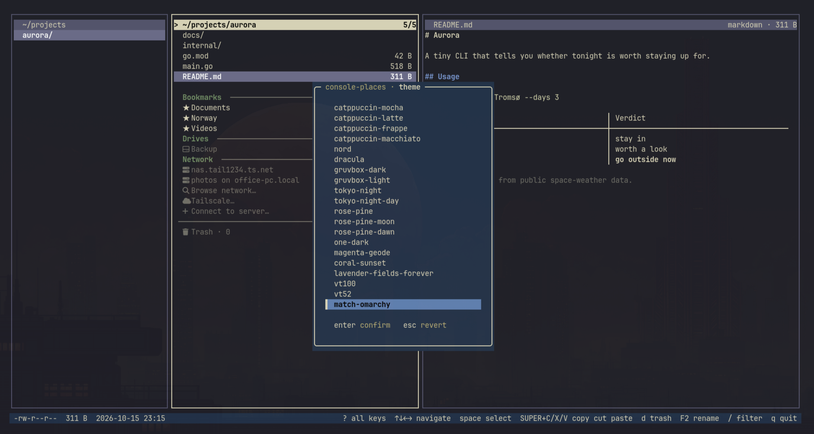
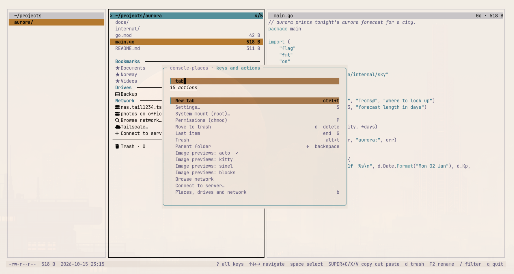
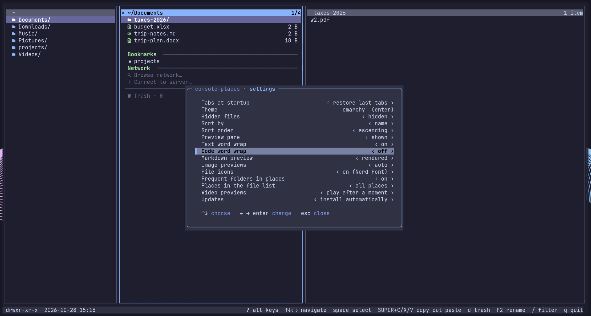
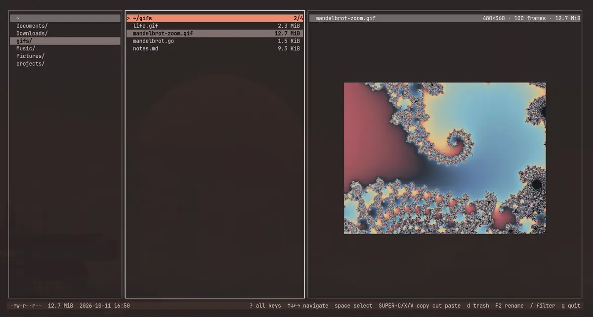
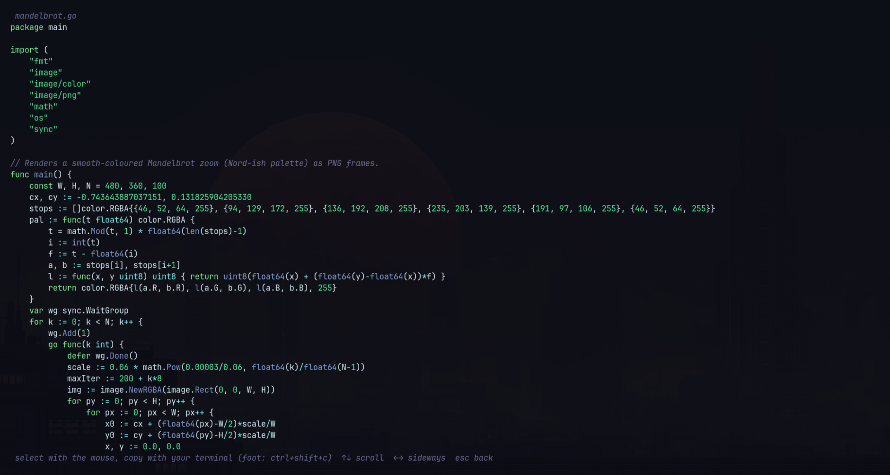
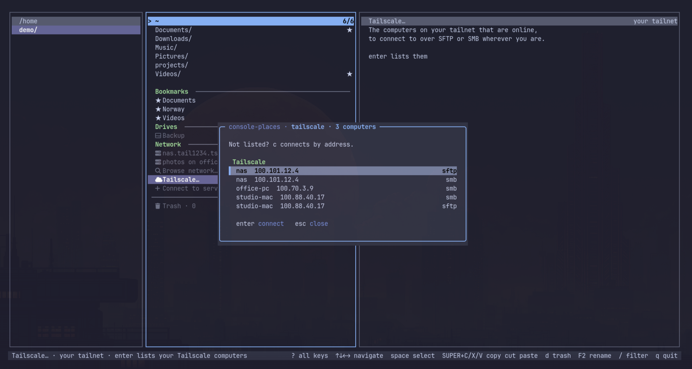
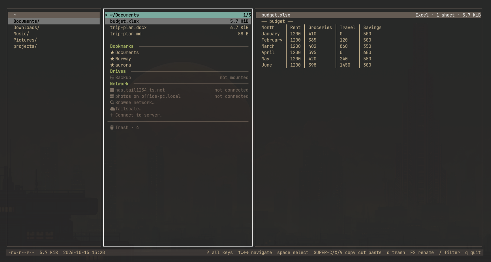
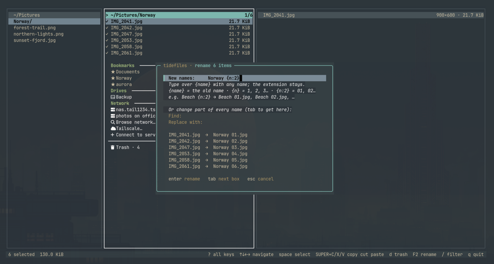

# console-places

A keyboard-first terminal file manager for Linux, built with Bubble Tea. Its UI components came
originally from [tideui](https://github.com/allisonhere/tideui) by [@allisonhere](https://github.com/allisonhere).

**Formerly tidefiles.** It was renamed console-places in v0.11; see
[Coming from tidefiles](#coming-from-tidefiles).


<table>
  <tr>
    <td></td>
    <td></td>
    <td></td>
  </tr>
  <tr>
    <td align="center">Inline images (sixel in foot) · Everforest</td>
    <td align="center">Browse inside archives · Gruvbox</td>
    <td align="center">Theme picker · Kanagawa</td>
  </tr>
  <tr>
    <td></td>
    <td></td>
    <td></td>
  </tr>
  <tr>
    <td align="center">Tabs · Tokyo Night</td>
    <td align="center"><code>?</code> palette: every action, searchable · Rosé Pine</td>
    <td align="center">A real Trash with restore · Nord</td>
  </tr>
  <tr>
    <td></td>
    <td></td>
    <td></td>
  </tr>
  <tr>
    <td align="center">Settings (<code>S</code>) · Osaka Jade</td>
    <td align="center">Animated GIFs, played in the preview · Ristretto</td>
    <td align="center">Drag in the preview to copy text · Hackerman</td>
  </tr>
  <tr>
    <td></td>
    <td></td>
    <td></td>
  </tr>
  <tr>
    <td align="center">Places in the list, Tailscale computers · Catppuccin</td>
    <td align="center">Office documents previewed · Gruvbox</td>
    <td align="center">Rename many at once · Everforest</td>
  </tr>
</table>

- **Three panes** — parent, current folder, and a preview (yazi-style). `shift+←/→` resizes the preview, `p` hides it.
- **A preview that understands your files** — real inline images (sixel in foot/wezterm/mlterm, kitty graphics in
  kitty/ghostty, half-block fallback anywhere else), animated GIFs, PDF first pages, videos that play (muted, after a moment on the file; `alt+p` plays or pauses) with length, resolution and codec, syntax-highlighted code
  in your Omarchy colors, rendered markdown (`m` shows the source), pretty-printed JSON, archive contents, audio tags, folder contents.
  From Windows and Mac shares too: Word, Excel, PowerPoint and OpenDocument files and RTF as their text
  (a spreadsheet's first sheet as a table), binary plists, UTF-16 text (`.reg`, `.inf`, `.strings`…),
  `.lnk` shortcuts (where they point), `.exe`/`.dll` details (product, company, version) and a Mac
  `.app`'s name and version.
- **Word-wrapped preview** — long lines of text wrap at word boundaries, while code truncates (`…`) by
  default; `w` toggles wrapping for whichever is shown, and Settings has both (*Text word wrap*, *Code word wrap*).
- **Copy text from the preview** — drag over the preview to select; letting go copies it to the clipboard
  as the file's own text (tabs kept, wrapped lines joined). The selection stays inside the preview pane;
  dragging past its edge scrolls. A click or any key clears it.
- **Shortcut strip + help palette** — common keys are always in the status bar. `?` lists every action
  by category with its key; type to filter (names, synonyms or keys), `enter` runs it. It also holds the
  settings without a key (sort mode, image previews), and your recent actions come first.
- **Follows your Omarchy theme** — live, no restart. `T` opens a theme picker.
- **A modern file manager's toolbox** — select, copy / cut / paste (the system clipboard gets file lists
  for file managers and paths for terminals and editors), trash with **undo**, rename (several at once: a template like `Holiday {n:2}` or find & replace, with a live preview), new file/folder, properties (folder sizes counted in the background: size and space on disk), permissions (chmod), open with…, places and
  bookmarks, back/forward history, filter, fuzzy find across subfolders, search inside files (ripgrep when installed; `alt+r` for regex), sort, terminal here, mouse support.
- **File icons** (opt-in) — Settings (`S`) → *File icons* puts a Nerd Font icon before each name
  (folders, code by language, images, video, audio, archives, documents, executables), coloured from
  your theme.
- **Tabs** — `ctrl+t` opens a tab on the current folder, `ctrl+w` closes it, `tab`/`shift+tab` or `1`…`9`
  switch; each tab keeps its own folder, selection and history. Tabs are reopened next time on the tab
  you were last in; started with a folder (`console-places ~/Music`), that folder's tab is active (added if
  none is open there). Settings can restore tabs only when no folder is given, or never.
- **Settings page** — `S` lists every preference (tabs at startup, theme, hidden files, sort, preview
  pane, text and code word wrap, markdown, image previews, file icons, frequent folders, places in the file list, video previews, updates); `←`/`→` change one, and it's saved straight away.
- **Keeps itself up to date** — release binaries check for a new version once a day, install it after
  verifying its checksum, and ask before restarting (tabs come back), listing what's new since your
  version so you can jump straight in. `U` does it by hand; see
  [Updates](#install).
- **Archives** — `enter` on a zip/tar/7z/rar browses it like a read-only folder (`←` leaves);
  `X` extracts archives here (into a folder named after the archive, unless it has a single
  top-level folder); `Z` compresses the selection into a `.zip` or `.tar.gz`. Reading uses `bsdtar`
  (libarchive), with `7z` as a fallback.
- **Progress you can stop** — copies, moves, extracts and compression run in the background with a
  progress bar, sizes and an ETA in the status line; `esc` stops one, removing whatever it half-made.
- **Safe by default** — paste never overwrites (conflicts become `name (copy)`), delete goes to the
  freedesktop trash, and permanent delete asks first.
- **A real Trash** — a `Trash · 12` row is pinned at the bottom of your home folder (and in places;
  `alt+t` jumps there). The trash shows where each item came from and when it was deleted; `r` puts
  it back (as `name (2)` if something is there now), `D` deletes it forever, `E` empties the trash.
- **Places: bookmarks, drives and network** — `b` is the sidebar, in sections like Nautilus':
  - **Places in the file list** (opt-in) — Settings (`S`) → *Places in the file list* puts your
    bookmarks (or bookmarks, drives and network) and the Trash below the files in every folder,
    set apart by a gap and coloured section names. Down stops at the last file (held down, it stays
    there); one more press goes into them. *Browse network…* and *Connect to server…* end the
    Network section. `enter` opens, mounts or connects; `d` unmounts a drive, disconnects a
    network location, removes a bookmark or forgets a saved server (never touching files).
  - **Bookmarks** — `B` bookmarks the folder you're in (`B` again removes it); bookmarked folders
    show a `★`.
  - **Frequent** — the ten folders you go to most, ranked by frecency (visits, weighted by how
    recent: zoxide's scheme), are listed after the bookmarks. Every folder you open counts
    (except home, `/` and the Trash); the 200 best are remembered in `frequent.json` next to
    `config.json`, and folders that no longer exist drop out. In places, `B` pins one as a
    bookmark and `d` removes it from the list. Settings (`S`) → *Frequent folders in places*
    turns it off (nothing is recorded then), or *on, shared with zoxide* uses zoxide's database
    instead — `zoxide add` on every visit and `zoxide query` for the list — so your shell's `z`
    and console-places learn from each other; without zoxide that falls back to the built-in list.
  - **Drives** — every drive and partition that isn't part of the running system, mounted or not,
    with free space. `enter` mounts and opens one (an encrypted one asks for its passphrase); `u`
    unmounts it, and a USB drive is then powered off so it's safe to unplug. Uses udisks: no root,
    and your desktop asks for a password where one is needed.
  - **Network** — `c` connects to a server: `smb://` (Windows, Mac, Samba), `sftp://` (anything with
    ssh), `nfs://`, `ftp://`, `dav://`; `\\pc\share` and `user@host:/path` work too. Passwords and
    other questions are asked inside console-places; `ctrl+s` at the password saves it in your keyring,
    where Nautilus finds it too. **Browse network…** finds computers that share files (mDNS,
    WS-Discovery, NetBIOS) and lists a server's shares; with Tailscale installed, **Tailscale…**
    (under Network) lists your tailnet's online computers at once (by MagicDNS name, over SFTP or
    SMB), and Browse network… adds them under their own heading. Servers you connect to stay listed; `u`
    disconnects (if something is still using it, console-places names what and forces it on a second
    try), `d` forgets one. Connections go through gvfs, as in Nautilus, so they're
    shared with it. A connected computer's preview shows its address, the protocol, who you're signed
    in as and its free space, and folders on it are titled `computer: /path`.
- **New window** — `ctrl+n` opens console-places in this folder in a new terminal window
  (`xdg-terminal-exec`, the way Omarchy launches terminals, or `$TERMINAL`).

Drives use `udisks2` (`udisksctl`) and `lsblk`. Network locations need `gvfs` plus its backends
(`gvfs-smb`, `gvfs-nfs`; `gvfs-backends` on Debian/Ubuntu); browsing uses `avahi` and `smbclient`.
When one is missing, console-places says what it's for
and offers to install it with your package manager (as root, after you say yes). If your firewall
(ufw) drops the answers Windows PCs send while browsing, **Browse network…** explains and offers
(`f`) to allow just those: UDP from your own network, from the discovery ports 3702 and 137.
Once they're in, `f` in the same place offers to remove them again (only the rules console-places
added, found by their "console-places discovery" label).

Image previews use `imagemagick` (jpeg/svg/heic/…), `poppler` (PDF), `ffmpegthumbnailer` (video),
`libarchive` (archives) and `ffmpeg` (playing videos, audio tags) when installed. Settings (`S`) →
*Video previews* chooses: play after a moment (default), play with `alt+p` only, or a still frame. Set `CONSOLE_PLACES_IMAGES=blocks|sixel|kitty`
to override terminal detection.

## Install

console-places runs on **Linux** (x86_64 and arm64). It's built on Omarchy (Hyprland + foot) and works on
other desktops and in plain terminals too.
The system clipboard uses `wl-clipboard` on Wayland, or `xclip`/`xsel` on X11; without one, copy and
paste still work inside console-places. Outside Omarchy it uses its built-in themes (`T` picks one). Pick one of:

**Download a release binary** (no Go needed; static, x86_64 or arm64):

```sh
arch=amd64   # or arm64
curl -L https://github.com/linuxbren/console-places/releases/latest/download/console-places_linux_$arch.tar.gz | tar xz console-places
install -Dm755 console-places ~/.local/bin/console-places
```

Each [release](https://github.com/linuxbren/console-places/releases) also lists a `checksums.txt` to verify the download.

**Debian / Ubuntu, Fedora / openSUSE, Alpine:** download the package for your system from the
[latest release](https://github.com/linuxbren/console-places/releases/latest) and install it:

```sh
sudo apt install ./console-places_amd64.deb      # Debian, Ubuntu
sudo dnf install ./console-places_amd64.rpm      # Fedora (zypper install … on openSUSE)
sudo apk add --allow-untrusted console-places_amd64.apk   # Alpine
```

They pull in the optional helpers (`wl-clipboard`, `bsdtar`, `ripgrep`) as recommended packages.

**Arch Linux: build a package** with the PKGBUILD in [`contrib/arch`](contrib/arch) (it builds the release it
names from source, runs the tests, and pulls in the dependencies):

```sh
git clone https://github.com/linuxbren/console-places && cd console-places/contrib/arch
makepkg -si
```

**Nix** (flakes): `nix run github:linuxbren/console-places`, or add the flake's `packages.default` to your
configuration.

**With Go** (1.27 or newer):

```sh
go install github.com/linuxbren/console-places@latest
```

The binary lands in `$(go env GOPATH)/bin` (usually `~/go/bin`); make sure that's on your `PATH`.
Check any of them with `console-places --version`.

**Updates.** Once a day console-places checks GitHub for a new release, in the background. A release binary
installed as above (in a folder you can write, like `~/.local/bin`) updates itself: it downloads the
new release, checks it against the release's `checksums.txt`, makes sure it runs, swaps it in, and asks
whether to restart into it (your tabs come back), with the new features of every release since yours;
say no and it starts next time. Packages, the Arch
package, Nix and `go install` are never replaced behind their backs: console-places tells you a new version
is out and the command that updates it. `U` checks, installs or restarts by hand. Settings (`S`) →
Updates: install automatically (the default), notify only, or off.

**Coming from tidefiles.** Nothing to do for a release binary: it updates itself as usual and then
renames itself `console-places`, leaving `tidefiles` as a link so both commands work. Your settings
move from `~/.config/tidefiles` to `~/.config/console-places`, firewall rules it added are still
recognised, and `TIDEFILES_*` variables are still read. The `console-places` packages replace the
`tidefiles` ones; with `go install`, install `github.com/linuxbren/console-places@latest` and remove
the old `tidefiles` binary. If you added the `SUPER+C` snippet below, replace it with the new one:
the window title now starts with `console-places — `.

**Optional — `SUPER+C` on Omarchy.** `SUPER+V` and `SUPER+X` work out of the box, but foot keeps
the key Omarchy's `SUPER+C` sends to terminals for itself. To make `SUPER+C` copy in console-places,
append [`contrib/omarchy-super-c.lua`](contrib/omarchy-super-c.lua) (also in the release archives, and at
`/usr/share/console-places/omarchy-super-c.lua` with the Arch package) to `~/.config/hypr/bindings.lua`
(Hyprland reloads on save; check with `hyprctl configerrors`). It only affects windows titled
`console-places — …`; every other window keeps Omarchy's default. Without it, plain `c` copies.

## Run

```sh
console-places [dir]
console-places --cwd-file /tmp/console-places.cwd   # write final dir on quit, for a cd-on-exit shell wrapper
```

From a checkout, `go run . [dir]` works the same way.

Settings (theme, hidden files, wrap, sort, bookmarks, servers you connected to) are remembered in
`~/.config/console-places/config.json`; frequent folders in `frequent.json` beside it.

## Keys

Arrow keys first; vim keys work too. Press `?` for every action: type to find one, `enter` runs it.
`space` select · `SUPER+C`/`X`/`V` copy/cut/paste (plain `c`/`x`/`v` work too) · `d` trash · `ctrl+z` undo · `F2` rename (several selected: bulk rename) ·
`n`/`N` new file/folder · `/` filter · `f` find · `F` search inside files · `X` extract · `Z` compress · `ctrl+t`/`ctrl+w` tabs · `ctrl+n` new window · `alt+t` trash · `s` sort · `S` settings · `b` places, drives, network · `B` bookmark · `i` properties · `P` permissions · `o` open with · `T` theme. Drag over the preview to copy text.

`SUPER+C` needs a one-time Hyprland snippet on Omarchy — see [Install](#install).
